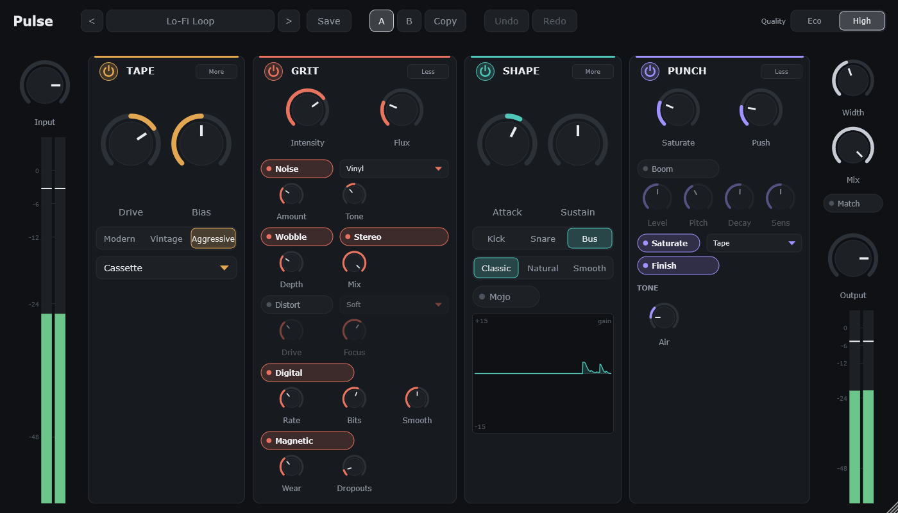

# Pulse

A drum processor for Windows: a VST3 plugin plus a standalone app, built with C++20 and JUCE 8. Four modules sit in signal order: **TAPE** (saturation & motion), **GRIT** (lo-fi & texture), **SHAPE** (transients) and **PUNCH** (sub boom, saturation & a true-peak safe finisher).



## Features

- Oversampled processing (Eco 2× / High 4×) with constant latency that is reported to the host
- Level-matched saturation, so Drive changes the character rather than the loudness, plus an optional loudness **Match**
- Level-independent transient shaping with look-ahead, and a kick-triggered sub **Boom**
- True-peak safe finisher (−0.5 dBTP)
- One-page resizable UI, factory and user presets, A/B compare, undo/redo
- Mono or stereo, 44.1–192 kHz, any buffer size

## Build

Needs Windows, Visual Studio 2022 (C++ workload) and CMake 3.22 or newer. JUCE is downloaded automatically.

```
cmake -S . -B build -G "Visual Studio 17 2022"
cmake --build build --config Release --parallel
```

This produces:
- `build/Pulse_artefacts/Release/VST3/Pulse.vst3`: copy the whole folder to `C:\Program Files\Common Files\VST3\`, then rescan plugins in your DAW.
- `build/Pulse_artefacts/Release/Standalone/Pulse.exe`

## Docs

- [User guide](docs/USER_GUIDE.md): installing in FL Studio, every control, presets
- [Changelog](docs/CHANGELOG.md): what changed from the original prototype, and why
- [DSP spec](docs/DSP_SPEC.md) and [comparison](docs/COMPARISON.md): analysis of the original and measurements
- Tests: `cd reference && node analyze_pulse.js` after building

## License

GPLv3, see [LICENSE](LICENSE). Pulse uses [JUCE](https://juce.com), which is available under AGPLv3 or a commercial license.
